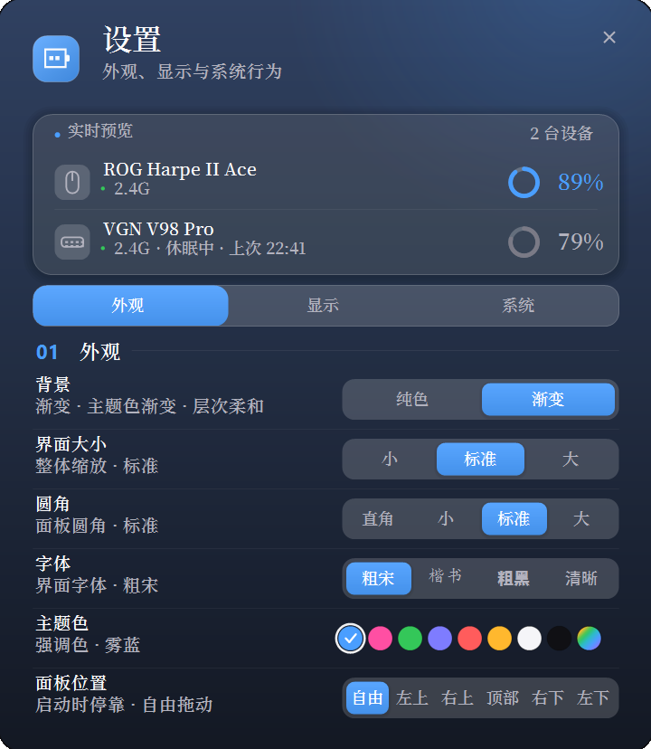
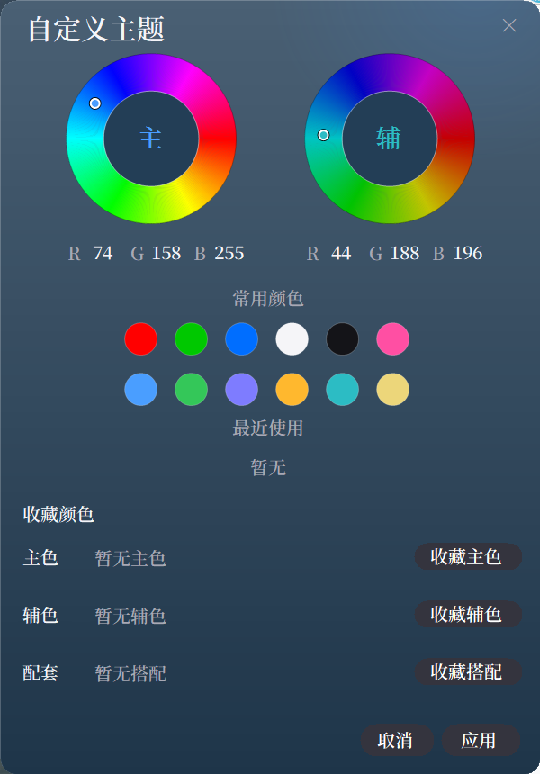

# 电环 · BatteryHalo

> 英文名 / 仓库名：**BatteryHalo**

## 一句话介绍

**电环**是一款面向 Windows 的桌面设备电量面板，用统一的方式查看有线 USB、2.4G 接收器和蓝牙设备的剩余电量，并提供可深度定制的界面、系统设置与耳机入耳控制。

它不是一个只按型号写死的电量小工具，而是围绕「设备当前通过什么方式连接」来识别和读取数据：同一台设备同时存在多条链路时，会自动合并为一张设备卡片，并标注当前主连接和备用链路。

---

## 项目定位

- **常驻桌面的轻量工具**：无边框圆角浮窗、托盘常驻、自动刷新。
- **多协议电量读取**：厂商 HID 协议、Windows 蓝牙电量属性、Apple 设备桥接三种通道并存。
- **可长期使用的桌面组件**：主题、字体、缩放、圆角、位置、设备顺序、透明度都可调，并支持主面板点击穿透和按设备显示的任务栏电量。
- **完整的中文界面**：面向日常使用，不依赖浏览器或外部服务。

---

## 核心功能

### 1. 三模电量识别

| 连接方式 | 识别方式 | 示例 |
| --- | --- | --- |
| 有线 USB | USB HID 设备 / 已知 VID:PID 表 | ROG 有线鼠标、VGN 有线键盘 |
| 2.4G | 接收器名称、VID:PID、HID 集合 | ROG SpeedNova 接收器、VGN Dongle |
| 蓝牙 | Windows 蓝牙设备节点与电量属性 | VGN V98 Pro BT、蓝牙耳机 |

- 同一设备的多条链路自动合并。
- 主连接优先级：**有线 > 2.4G > 蓝牙**。
- 设备休眠时回退显示上次读数，并标记「休眠中」。
- 低电量（低于 20%）使用深红色电量环；充电时优先显示金色与闪电。
- 首次扫描期间显示骨架屏，避免空白闪烁。

### 2. 主面板

- 无边框圆角浮窗，可拖动、可收起为小条、可收进托盘。
- 每个设备卡片包含：类型图标、型号、连接状态、电压/休眠信息、环形电量。
- 支持纯色 / 渐变两种背景，颜色随主题变化。
- 支持鼠标滚轮滚动设备列表。
- 支持直接拖动设备卡片调整顺序，顺序持久化。
- 右键菜单与托盘菜单统一使用主题化样式。

### 3. 设置中心

设置窗口采用「外观 / 显示 / 系统」三标签页，顶部保留实时预览，所有修改即时生效并自动保存。

- **外观**
  - 纯色 / 渐变背景
  - 粗宋 / 楷书 / 粗黑 / 清晰四种界面字体
  - 圆角四档
  - 界面缩放三档
  - 6 种预设主题色 + 霜雪 / 墨眉 / 自定义双色，共 9 档
  - 面板停靠位置
- **显示**
  - 连接方式显示开关
  - 面板展开 / 收起状态
  - 贴边自动直角
- **系统**
  - 开机自启
  - 忽略设备管理
  - 输出 / 输入音频设备切换
  - AirPods 入耳自动播放 / 暂停
  - 部分耳机自动刷新间隔

### 4. 自定义主题编辑器

自定义主题是一个独立的非模态窗口，支持实时预览，只有点击「应用」才正式保存。

- 两个 195×195 空心色环，分别编辑主色和辅色。
- 点击色环内部空白只切换当前编辑字段，不误取颜色。
- RGB 独立输入，支持 0–255 自动截断，数字无边框显示。
- 常用颜色、最近使用、收藏主色 / 辅色 / 搭配。
- 收藏与最近使用使用 48px 圆形色块，超出后横向滚动。
- 当前颜色显示白色选中边框与对号；白色等亮色自动改用黑色对号。
- 第一次点击收藏圆出现 ×，第二次点击删除。
- 收藏、最近使用、搭配均持久化，关闭窗口不会丢失。
- 自定义窗口与设置窗口相互独立，点击其中一个置顶不会连带另一个。

### 5. Apple / AirPods 支持

- 通过独立的 `AirPodsHelper.exe` 读取 AirPods / Beats 左右耳与充电仓电量。
- 设置页左右耳使用同尺寸电量环，充电仓单独一行。
- 支持入耳自动播放 / 暂停。
- 需要 .NET Framework 4.8 运行 AirPodsHelper。
- Apple Continuity 广播协议参考了 [AirPodsDesktop](https://github.com/SpriteOvO/AirPodsDesktop)，本项目只复用协议解析思路，界面与状态展示为自行实现。

---

## 界面预览

### 主面板


### 设置中心



### 自定义主题



---

## 技术实现

| 模块 | 说明 |
| --- | --- |
| 语言 / 框架 | C# 5 / .NET Framework 4.0 / WinForms |
| 绘制 | 完全自绘的无边框圆角窗口、渐变背景、自绘按钮与分段控件 |
| HID 通信 | P/Invoke 调用 Windows HID API，按厂商协议读写 Feature/Output Report |
| 蓝牙电量 | 读取 `DEVPKEY_Bluetooth_Battery` 设备属性 |
| 音频设备 | Core Audio 策略配置，切换默认输出/输入设备 |
| AirPods | 独立 .NET 4.8 辅助进程，主程序读取其 stdout 逐行 JSON（AirPodsBridge） |
| 配置 | `设置.ini` + 文本记录文件，绿色免安装 |
| 打包 | `build.ps1` 调用系统 `csc.exe` 编译单文件程序 |

### 项目结构

```text
电环/
├─ 源程序/
│  ├─ HidCore.cs          HID 设备枚举与报文通道
│  ├─ HeadsetBattery.cs   耳机电量读取
│  ├─ AirPodsBridge.cs    AirPods 辅助进程通信
│  ├─ AirPodsHelper.cs    AirPods BLE 辅助进程（.NET 4.8 / WinRT）
│  ├─ AudioDevices.cs     默认音频设备切换
│  ├─ Scanner.cs          设备扫描与三模合并
│  ├─ GlassStyle.cs       主题、背景、字体、圆角等视觉规则
│  ├─ MenuTheme.cs        右键菜单主题
│  ├─ Settings.cs         设置中心
│  ├─ ColorPairForm.cs    自定义主题编辑器
│  ├─ ColorWheel.cs       色环控件
│  ├─ Ui.cs               主面板与托盘
│  ├─ TaskbarBadge.cs     任务栏电量徽标
├─ lib/                   InTheHand 蓝牙库
├─ AirPodsHelper.exe      AirPods 辅助进程
├─ 电环.exe        主程序
├─ build.ps1              主程序编译脚本
├─ build-helper.ps1       AirPodsHelper 编译脚本（优先 SDK，缺失用 WinMetadata）
├─ 设置界面预览.png
├─ 自定义配色预览.png
└─ README.md              更详细的技术记录
```

---

## 运行与构建

### 直接运行

双击 `电环.exe` 即可，无需安装。

- 主程序：Windows 10 / 11，.NET Framework 4.0
- AirPods 辅助进程：.NET Framework 4.8
- 首次运行会在程序目录生成 `设置.ini`、设备记录等文本文件。

### 重新编译

```powershell
cd E:\电环

# 主程序（.NET 4.0，无需 SDK）
powershell -ExecutionPolicy Bypass -File .\build.ps1

# AirPodsHelper（.NET 4.8 / WinRT，优先 Windows SDK，缺失时用系统 WinMetadata）
powershell -ExecutionPolicy Bypass -File .\build-helper.ps1

# 两者一起构建
powershell -ExecutionPolicy Bypass -File .\build.ps1 -WithAirPodsHelper
```

编译前需要先退出正在运行的程序。主程序脚本会调用系统自带的 `csc.exe`，生成单文件 `电环.exe`。
`build-helper.ps1` 会先查找 SDK 的 `Windows.winmd`；找不到时自动改用 `C:\Windows\System32\WinMetadata`，无需安装 SDK。

---

## 已知边界

- 电量读取依赖设备厂商协议；未适配的型号可能只能显示连接状态，无法显示电量。
- 2.4G 接收器与蓝牙链路的回包延迟不同，个别设备可能需要等待 1–3 秒。
- 蓝牙电量来自 Windows 设备属性，不是所有蓝牙设备都会上报。
- AirPods 功能需要额外运行 `AirPodsHelper.exe`，并依赖 .NET 4.8。
- 不同 Windows 版本、不同接收器固件下，厂商 HID 报文可能存在差异。

---

## 项目特点总结

**它不是单纯的“电量显示”，而是一套围绕设备连接状态构建的桌面设备面板：**

- 三模识别与多链路合并
- 厂商协议 + 系统属性 + Apple 桥接三种读数通道
- 自绘主题系统与完整自定义配色编辑器
- 设置、托盘、右键菜单、音频设备统一视觉
- 绿色单文件、配置文本化、可持续维护

适合需要同时管理多把键盘、鼠标、耳机，并希望桌面工具保持统一视觉风格的用户。
